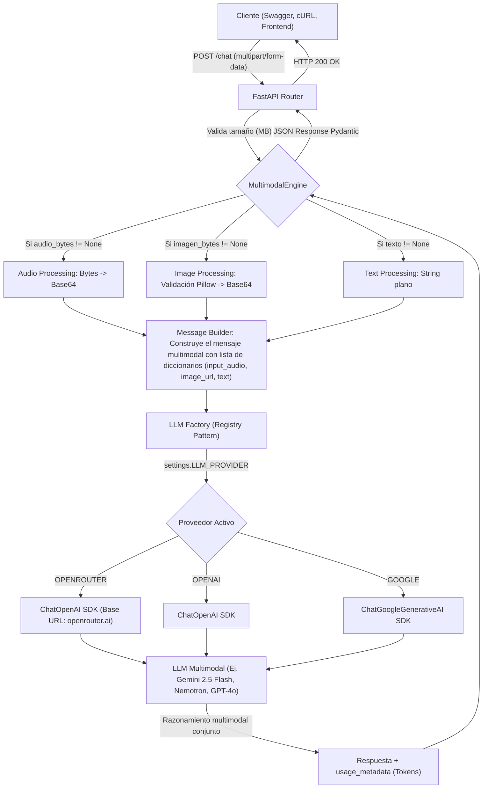

# Architecture Design & Technical Decisions

Este documento detalla la arquitectura del **Multimodal Chatbot API**, los flujos de datos y las decisiones críticas de ingeniería que dieron forma al sistema.

## 1. Diagrama de Flujo del Sistema (Data Pipeline)

El siguiente diagrama ilustra cómo viaja la información desde que el usuario hace una petición hasta que recibe la respuesta, utilizando **OpenRouter** como orquestador principal de modelos.



## 2. Deep Dive: El Flujo del Audio Nativo
Una de las decisiones más importantes del proyecto fue **eliminar la dependencia de Whisper** (Speech-to-Text) y optar por el **Audio Nativo** en OpenRouter.

**¿Cómo funciona internamente?**

1. El cliente envía un archivo de audio (ej. `audio_soporte.mp3`) en la petición `multipart/form-data`.
2. FastAPI (`main.py`) recibe el archivo como un objeto `UploadFile` y extrae sus bytes (`audio.read()`).
3. `MultimodalEngine` recibe los bytes y los codifica a **Base64**.
4. Se construye un bloque de mensaje con el formato que exige la API de OpenAI/OpenRouter:

```json
{
    "type": "input_audio",
    "input_audio": {
        "data": "<cadena_base64_aqui>",
        "format": "mp3"
    }
}
```
5. Este bloque se empaqueta junto con la imagen (si existe) y el texto en un objeto `HumanMessage`.
6. El LLM multimodal recibe el mensaje y procesa el audio, la imagen y el texto **simultáneamente**.

**¿Por qué se abandonó Whisper?**

- **Latencia**: Whisper es un paso extra (Audio -> Texto -> LLM). El audio nativo es directo (Audio + Imagen + Texto -> LLM).
- **Pérdida de contexto**: Whisper solo transcribe palabras. Un LLM multimodal puede "escuchar" el tono de voz, las pausas y la emoción, combinándolo con lo que ve en la imagen.
- **Complejidad**: Mantener dos APIs (Groq para Whisper, OpenRouter para el LLM) duplicaba las llaves de entorno y los proveedores.


## 3. Decisiones de Diseño Clave

**Provider-Agnostic (OpenRouter)**

En lugar de atarnos a un solo proveedor, usamos **OpenRouter**. Esto nos permite:

1. Usar una sola API Key para docenas de modelos (GPT-4o, Gemini, Nemotron).
2. Cambiar de modelo simplemente editando `OPENROUTER_MODEL` en el `.env`.
3. Evitar el "vendor lock-in" (dependencia exclusiva de un proveedor).

**Validación de Archivos con Pillow (Seguridad)**

El endpoint `/chat` es público. Para evitar ataques de "Path Traversal" o denegación de servicio (DoS) mediante la subida de archivos maliciosos:

1. FastAPI valida que el campo sea un archivo.
2. `image_service.py` usa **Pillow** para intentar abrir la imagen.
3. Si Pillow falla, se lanza un `ValueError` y FastAPI devuelve un **HTTP 400**.
4. Esto asegura que un usuario no pueda subir un `.exe` o un script renombrado a `.jpg`.

## 4. Patrones de Diseño y Principios SOLID

**Registry Pattern (Open/Closed Principle)**
En `llm_factory.py`, en lugar de usar una cadena de `if/elif`, usamos un diccionario:

```python
_PROVIDER_REGISTRY = {
    "OPENROUTER": _build_openrouter,
    "OPENAI": _build_openai,
    "GOOGLE": _build_google,
}
```

Si mañana queremos agregar `ANTHROPIC`, solo creamos `_build_anthropic()` y lo agregamos al diccionario. El código central de get_llm() no se modifica.

**Dependency Inversion Principle (DIP)**

`MultimodalEngine` **no depende** de implementaciones concretas como `ChatOpenAI`. Depende de la abstracción `get_llm()`. Esto permite que en los tests (con `monkeypatch`) podamos inyectar un `MagicMock` sin tocar el código de negocio.

**Strategy Pattern**
La variable `LLM_PROVIDER` en el archivo `.env` actúa como el "contexto" que define qué estrategia (proveedor) se usará en tiempo de ejecución. El código cliente no sabe ni le importa qué proveedor está activo.

**Singleton**
`config.py` usa `@lru_cache` para garantizar que `Settings()` se instancie una sola vez en todo el ciclo de vida de la aplicación. Esto evita leer el archivo `.env` cientos de veces por petición.

## 5. Componentes de Software y Responsabilidades

| Componente | Archivo | Responsabilidad Única (SRP) |
| :--- | :--- | :--- |
| **API Layer** | `app/main.py` | Recibir peticiones HTTP, validar tamaños máximos, manejar excepciones y devolver JSON. |
| **Config** | `app/core/config.py` | Cargar y validar variables de entorno con Pydantic. Validar credenciales al arranque (fail-fast). |
| **LLM Factory** | `app/core/llm_factory.py` | Instanciar el cliente de LLM correcto basándose en el Registry Pattern. |
| **Image Service** | `app/core/image_service.py` | Validar imágenes con Pillow y convertirlas a Base64. |
| **Multimodal Engine** | `app/services/multimodal_engine.py` | Orquestar la construcción del `HumanMessage` (Texto, Imagen, Audio) e invocar al LLM. |
| **Schemas** | `app/models/schemas.py` | Definir los contratos de entrada/salida (Pydantic) y documentación automática (Swagger). |


## 6. Flujo de Errores (Resiliencia)

El sistema está diseñado para fallar de forma segura y predecible:

1. **Archivo demasiado grande**: Validado en `main.py` (Límite: 10MB imagen, 25MB audio). Devuelve HTTP 400.
2. **Imagen corrupta o falsa**: Validado por Pillow en `image_service.py`. Devuelve HTTP 400.
3. **Petición vacía**: Validado en `multimodal_engine.py` (si no hay texto, ni imagen, ni audio). Devuelve HTTP 400.
4. **Fallo del Proveedor LLM (Timeout, API Key inválida)**: Capturado por el bloque `except Exception` en `main.py`. Devuelve HTTP 500 con un mensaje controlado (sin exponer trazas internas al usuario).
5. **Falta de API Key al arrancar**: `settings.validate_provider_credentials()` lanza un `ValueError` que detiene el servidor (SystemExit) antes de aceptar tráfico.
