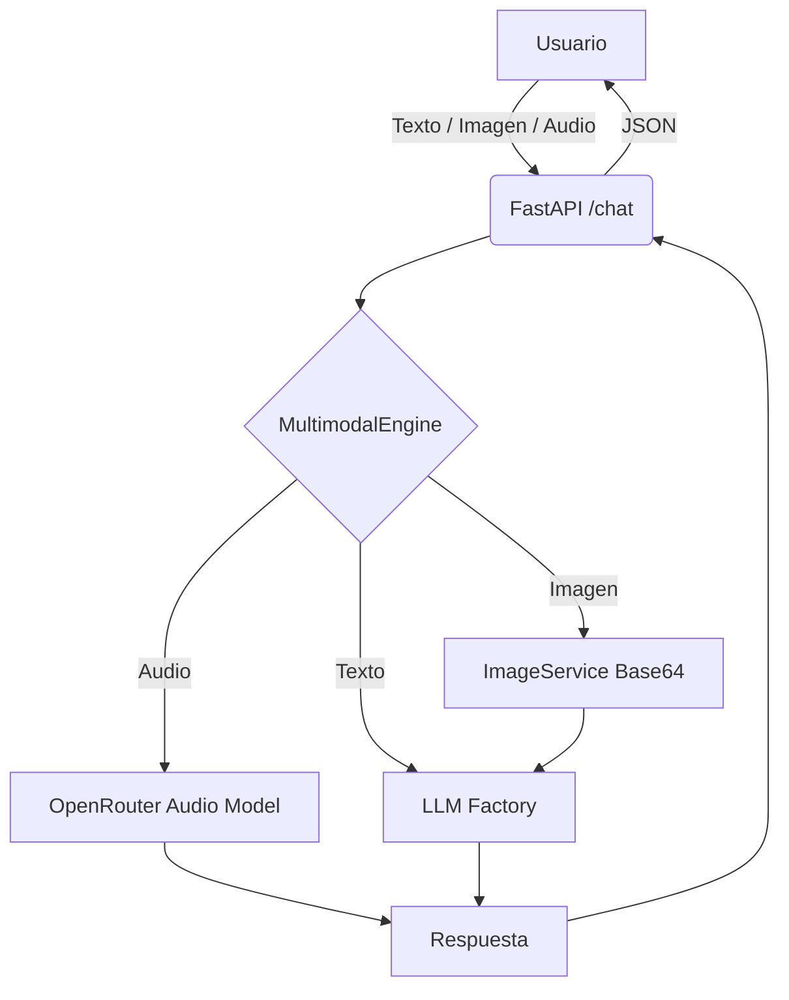

# 🤖 Multimodal Chatbot API

[](https://codecov.io/github/enriquehernandez/multimodal-chatbot)

   

> **API REST multimodal (texto + imagen + audio) impulsada por OpenRouter.**  
> Diseñada con FastAPI, LangChain, y un pipeline de evaluación automatizado con LLM-as-a-Judge.

## 🎯 ¿Qué hace este proyecto?

Una API construida con **FastAPI** que recibe **texto, imágenes y/o audio** en una misma petición y devuelve una respuesta generada por un LLM. Utiliza **OpenRouter** como proveedor principal, lo que permite cambiar entre modelos (GPT-4o, Gemini, Nemotron, etc.) con una sola API Key.

### Características principales

| Característica | Descripción |
| :--- | :--- |
| 🎙️ **Audio → Texto** | Transcripción automática con **Whisper** (OpenAI). |
| 🖼️ **Imagen → Contexto** | Codificación **Base64** + validación con **Pillow**. |
| 🧠 **Multimodalidad real** | Procesa imágenes, audios (nativo, sin Whisper externo) y texto. |
| 🔄 **Provider-Agnostic** | **Registry Pattern** para cambiar alternar entre OpenRouter, OpenAI y Google, sin tocar código. |
| 🛡️ **Seguridad** | Validación de MIME types con Pillow, límites de tamaño y cero hardcoding. |
| 📊 **Evaluación** | Pipeline **LLM-as-a-Judge** (`scripts/evaluate.py`) que audita la calidad de las respuestas. |
| 🧪 **Testing** | 100% de cobertura en `app/` con **mocks** (no consume tokens). |
| 📚 **Documentación** | Blueprint completo en [`PRODUCT_BLUEPRINT/`](./PRODUCT_BLUEPRINT/). |

---

## 🏗️ Arquitectura



📐 Más detalles de arquitectura, patrones de diseño (SOLID, Registry, Strategy) y diagramas de secuencia en [Product Blueprint](PRODUCT_BLUEPRINT/README.md).

## 🚀 Instalación rápida
**Requisitos previos**

- Python 3.11 o 3.12
- uv (gestor de paquetes ultrarrápido)
- Una API key de al menos uno de los proveedores soportados

**Pasos**

```bash
# 1. Clonar el repositorio
git clone https://github.com/enriquehernandez/multimodal-chatbot.git
cd multimodal-chatbot

# 2. Instalar dependencias con uv
uv sync

# 3. Copiar el archivo de variables de entorno
cp .env.example .env

# 4. Editar .env y configurar al menos un proveedor
#    (por defecto usa OPENAI con GPT-4o)

# 5. Levantar el servidor
uv run uvicorn app.main:app --reload --port 8002
o
uv run tom dev
```

La API estará disponible en `http://localhost:8002` y la documentación interactiva (Swagger) en `http://localhost:8002/docs`.

## ⚙️ Configuración
Toda la configuración se gestiona mediante variables de entorno (`.env`). El archivo `.env.example` incluye todas las opciones:

```env
# ====== Configuración general ======
LLM_PROVIDER=OPENAI            # OPENAI | AZURE_OPENAI | GROQ | GOOGLE
MAX_IMAGE_SIZE_MB=10
MAX_AUDIO_SIZE_MB=25

# ====== OpenAI ======
OPENAI_API_KEY=sk-...
OPENAI_MODEL=gpt-4o

# ====== Azure OpenAI ======
AZURE_OPENAI_API_KEY=...
AZURE_OPENAI_ENDPOINT=https://tu-recurso.openai.azure.com/
AZURE_OPENAI_DEPLOYMENT=gpt-4o
AZURE_OPENAI_API_VERSION=2024-08-01-preview

# ====== Groq ======
GROQ_API_KEY=gsk_...
GROQ_MODEL=llama-3.2-90b-vision-preview

# ====== Google ======
GOOGLE_API_KEY=...
GOOGLE_MODEL=gemini-1.5-pro
```

*🔑 **Cambiar de proveedor** es tan simple como modificar `LLM_PROVIDER` en el .env y reiniciar el servidor. Gracias al **Registry Pattern** en `app/core/llm_factory.py`, no hay que tocar una sola línea de código.*

## 📡 Uso de la API
**Endpoint principal: POST /chat**
Acepta `multipart/form-data` con los siguientes campos (todos opcionales, pero al **menos uno** debe estar presente):

| Campo | Tipo | Descripción |
| :--- | :--- | :--- |
| **texto** | string | Consulta en lenguaje natural. |
| **imagen** | file | Imagen en formato JPG, PNG, WEBP o GIF (máx. 10 MB). |
| **audio** | file | Audio en formato MP3, WAV, M4A u OGG (máx. 25 MB). |

**Ejemplo con curl (texto + imagen)**

```bash
curl -X POST http://localhost:8002/chat \
  -F "texto=¿Qué problema ves?" \
  -F "imagen=@data/images/laptop_bsod.png" \
  -F "audio=@data/audio/audio_soporte.mp3"
```

Respuesta:

```json
{
  "answer": "En la imagen se observa un coche rojo deportivo estacionado frente a un edificio moderno.",
  "tokens_used": {
    "prompt_tokens": 1523,
    "completion_tokens": 28,
    "total_tokens": 1551
  }
}
```

**Ejemplo con curl (audio + texto)**
```bash
curl -X POST http://localhost:8000/chat \
  -F "texto=Resume lo que digo en el audio" \
  -F "audio=@data/audio/consulta.mp3"
```

**Ejemplo con curl (las tres modalidades)**

```bash
curl -X POST http://localhost:8000/chat \
  -F "texto=¿Qué relación hay entre lo que digo y lo que ves?" \
  -F "imagen=@data/images/planta.jpg" \
  -F "audio=@data/audio/descripcion.mp3"
```

**Endpoint de salud: GET /health**
```bash
curl http://localhost:8000/health
# {"status": "ok"}
```

## 📊 Evaluación (LLM-as-a-Judge)
El proyecto incluye un script que audita la calidad del chatbot usando un set de pruebas con *Ground Truth*.

```bash
uv run python scripts/evaluate.py
```

**Resultados actuales:**

| Caso | Tipo	Pregunta | Puntaje
| :--- | :--- | :--- |
| test_01 | Imagen | ¿Qué problema se ve en la imagen?	10/10
| test_02 | Audio | ¿Qué necesita el usuario?	10/10


## 🧪 Testing
El proyecto usa mocks para todas las dependencias externas (LLM, Whisper, imágenes), por lo que los tests son rápidos, gratuitos y deterministas.

```bash
# Correr todos los tests con reporte de cobertura
uv run pytest tests/ --cov=app --cov-report=term-missing

# Correr solo un archivo específico
uv run pytest tests/test_multimodal_engine.py -v

# Generar reporte HTML de cobertura
uv run pytest tests/ --cov=app --cov-report=html
# Abrir htmlcov/index.html en el navegador

o

uv run tom test 
```

**Cobertura actual**

| Módulo | Cobertura |
| :--- | :--- |
| app/core/config.py | 100% |
| app/core/llm_factory.py | 100% |
| app/core/audio_service.py | 100% |
| app/core/image_service.py | 100% |
| app/services/multimodal_engine.py | 100% |
| app/main.py | 100% |
| app/models/schemas.py | 100% |


*🧪 Estrategia de testing detallada en PRODUCT_BLUEPRINT/03_SECURITY_AND_AUDIT/02_testing_strategy.md.*


## 🧠 Decisiones de diseño destacadas
**¿Por qué Registry Pattern en lugar de if/elif?**
Porque cumple con el **principio Open/Closed de SOLID**: agregar un nuevo proveedor (por ejemplo, Mistral o Cohere) solo requiere crear una función `_build_mistral()` y añadir una línea al diccionario `_PROVIDER_REGISTRY`. La lógica central de `get_llm()` no se toca.

```python
_PROVIDER_REGISTRY = {
    "OPENAI": _build_openai,
    "AZURE_OPENAI": _build_azure_openai,
    "GROQ": _build_groq,
    "GOOGLE": _build_google,
}
```

**¿Por qué FastAPI?**

- **Async nativo**: ideal para llamadas a APIs de LLM (I/O-bound).
- **Swagger automático**: documentación interactiva sin esfuerzo.
- **Pydantic**: validación de datos y tipado estricto.

**¿Por qué mocks en los tests?**
Para que los tests sean **rápidos (milisegundos), gratuitos (no consumen tokens) y deterministas (no dependen de la red)**. Esto permite correrlos en cada git push sin costos.

*📐 Más detalles en PRODUCT_BLUEPRINT/01_DESIGN_SYSTEM/01_software_engineering.md.*

## 🗺️ Roadmap

☑ Soporte multimodal (texto + imagen + audio).
☑ Provider-Agnostic con Registry Pattern.
☑ Evaluación con LLM-as-a-Judge.
☑ Tests con mocks y cobertura 100%.
□ LangGraph: agente autónomo que decida cuándo usar herramientas (Tool Calling).
□ Memoria conversacional: mantener contexto entre múltiples turnos.
□ Streaming: respuestas en tiempo real con Server-Sent Events (SSE).
□ Docker + CI/CD: imagen lista para producción y GitHub Actions.

## 🧑‍💻 Autor
Enrique Hernández Leiva
* [LinkedIn](https://www.linkedin.com/in/enrique-hernandez-leiva/)
* [GitHub](https://github.com/enriquehernandez)